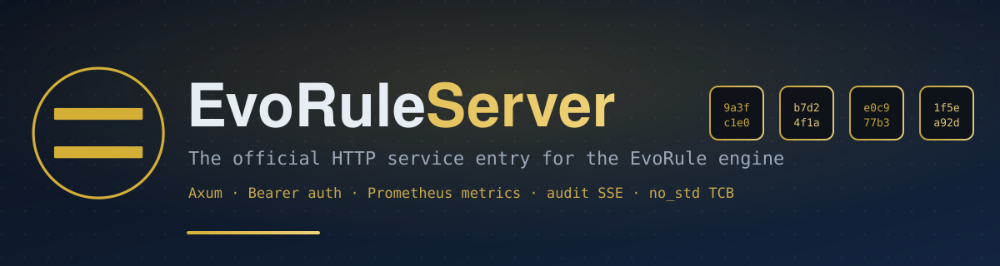

<!--
  Copyright 2026 EvoRule Project

  SPDX-License-Identifier: AGPL-3.0-or-later

  This file is part of EvoRule Server, licensed under GNU Affero General Public License v3 or later.
-->



# EvoRule Server

Official HTTP entrypoint for the evorule engine: session API, audit SSE, hot-reload, auth, and template marketplace.

[![CI][badge-ci]][ci-link]
[![License: AGPL-3.0-or-later][badge-license]][license-link]

**License**: [AGPL-3.0-or-later](LICENSE) with [dual licensing](DUAL_LICENSE.md)

The core engine ships as `evorule-tcb` / `evorule-reactor` / `evorule-governance` on crates.io (pure-function execution, reactive runtime with hash-chain WAL, session management + auditor). This repo wraps those capabilities into a remotely accessible, monitorable, integrable service — HTTP entry points, session management, audit stream, Prometheus metrics, authentication & user system, I/O handler orchestration, debug controls, and template marketplace. It **never modifies core engine code**; core changes go through crates.io releases.

## Quick Start

1. **Build**:

```bash
git clone https://github.com/evorule/evorule-server.git
cd evorule-server
cargo build --release
```

2. **Start** — minimal start (sessions / audit / time machine / rule hot-reload), listens on `0.0.0.0:18080`, stores data in `./data/`:

```bash
./target/release/evorule-server
```

> Enabling `call_external` / `call_service` requires an explicit service registry mount, otherwise any `service_name` call returns `unknown service_name`: `--service-registry ./service_registry.json --allow-loopback`. The repo ships a built-in `service_registry.json` (with `echo_svc` / `llm_advisor` examples) and an `echo_server.py` demo backend.

3. **First session**:

```bash
# Health check
curl http://localhost:18080/api/health

# Create session (no request body needed)
curl -X POST http://localhost:18080/api/sessions

# Submit command (set counter=1)
curl -X POST http://localhost:18080/api/sessions/<session_id>/command \
  -H "Content-Type: application/json" \
  -d '{"instruction":{"type":"set","params":{"attr":"counter","operation":"set","value":1}}}'

# Query state
curl http://localhost:18080/api/sessions/<session_id>/state
```

4. **Platform auth** (multi-user scenarios — single-machine/embedded scenarios can skip this; no auth configured = fully open, dev-only):

```bash
# Bootstrap create admin (only available when the platform has no users, else 409)
curl -X POST http://localhost:18080/api/platform/auth/bootstrap \
  -H "Content-Type: application/json" \
  -d '{"username":"admin","password":"<min 8 chars>","display_name":"Admin"}'

# Login to get session token
curl -X POST http://localhost:18080/api/platform/auth/login \
  -H "Content-Type: application/json" \
  -d '{"username":"admin","password":"<password>"}'
```

Business APIs are protected by unified auth middleware, **triple-channel**: static Bearer token (`--auth-token`) **or** platform session token **or** app credential key (issued via `/api/platform/apps`, attributed by `app_id` in the audit chain) — any one works, unified 401 semantics. App credentials support optional per-app rate limits and daily quotas (`429` + `Retry-After` when exceeded). All auth events land in the audit fact chain, queryable via `/api/audit/platform-events`.

## Installation & Deployment

**Docker** (recommended):

```bash
docker build -t evorule-server .
docker run -d --name evorule-server -p 18080:18080 -v $(pwd)/data:/data -e EVORULE_AUTH_TOKEN=<your-secret> evorule-server
```

**Binary**:

```bash
cargo build --release
./target/release/evorule-server
```

Performance benchmarks live in `examples/` (`bench_determinism` / `bench_throughput` / `bench_long_session`), with load-drill scripts in `scripts/load-drill.ps1`.

> Upgrade note: this repo and the core engine crates evolve audit-chain fact formats synchronously — upgrade them in lockstep, never mix old/new combinations. A WAL written with new fact types is **explicitly rejected** by an older process (fail-fast, never silently dropped); back up `data/` before upgrading.

## Usage

The API lives under `/api`, grouped by functional domain — the single source of truth is `GET /api/openapi.json` (Swagger UI requires `--openapi-ui`):

| Group | Scope | Representative endpoints |
|---|---|---|
| Health & meta | liveness/readiness probes, OpenAPI doc, plugin approval proxy | `GET /api/health` · `GET /api/health/readiness` · `GET /api/openapi.json` |
| Session & execution | create/close, command, I/O response, SSE events, time machine (rewind/diff/fork), debug control | `POST /api/sessions` · `POST /api/sessions/{id}/command` · `GET /api/sessions/{id}/events` (SSE) · `GET /api/sessions/{id}/rewind` |
| Audit | report / verify / export / import, causal trace, WAL archive | `GET /api/sessions/{id}/audit/verify` · `GET /api/sessions/{id}/audit/export` · `GET /api/audit-archive/sessions` |
| Facts | session facts, shared facts + rollup, source/consumer trace | `GET /api/sessions/{id}/facts` · `POST /api/shared/facts/rollup` |
| Platform auth | bootstrap/login, users / roles / permissions, app credentials + quotas | `POST /api/platform/auth/bootstrap` · `POST /api/platform/auth/login` · `POST /api/platform/apps/{id}/quota` |
| Rules | bundle import (6 validations + atomic commit), validate / hot-reload, hit statistics | `POST /api/bundles/import` · `POST /api/rules/reload` · `GET /api/rules/hit-stats` |
| Services & data | knowledge channel, template marketplace, PDF export, workspaces, `/metrics` | `GET /api/services` · `GET /api/knowledge` · `POST /api/export/pdf` · `GET /metrics` |

The full endpoint tables: [docs/API_REFERENCE.md](docs/API_REFERENCE.md).

## Configuration

Loading priority: **CLI args > env vars (prefix `EVORULE_`) > JSON config file > built-in defaults**. Key settings:

| Variable | Default | Description |
|---|---|---|
| `EVORULE_ADDR` | `0.0.0.0:18080` | Listen address |
| `EVORULE_AUTH_TOKEN` | (empty) | Bearer token (empty = auth off, dev only) |
| `EVORULE_INSECURE_SERVE` | (empty) | Explicit no-auth acknowledgment (`1`; loopback binds only — non-loopback without token is rejected at startup) |
| `EVORULE_SERVICE_TOKEN` | (empty) | Trusted service pipe token (can write to protected domains `stable.llm`/`stable.system`) |
| `EVORULE_CORE_EVAL` | `./resources/server_eval.json` | Constitution file path (not hot-reloadable) |
| `EVORULE_RULES_DIR` | `./rules` | Business rules directory (hot-reload monitored) |
| `EVORULE_DB_PATH` | `./data/evorule.db` | SQLite database path |
| `EVORULE_WAL_DIR` | (empty) | WAL directory (enables persistence when set) |
| `EVORULE_SERVICE_REGISTRY` | (empty) | service_name→URL mapping file (empty registry = all external service calls return `unknown service_name`) |
| `EVORULE_PLUGINS` | (empty) | Plugin manifest file (unconfigured = all native plugins enabled) |
| `EVORULE_ALLOWED_ORIGINS` | (empty) | CORS allowed Origin list (empty = same-origin only) |
| `EVORULE_OPENAPI_UI` | `false` | Mount Swagger UI (`GET /api/docs`) |

A JSON config file (`--config evorule.json`) mirrors the same settings; the full variable table, the discipline-gate modes, and the plugin-manifest semantics: [docs/CONFIGURATION.md](docs/CONFIGURATION.md).

Plugins are enabled/disabled at deployment time via the manifest file (`--plugins`), with fail-fast validation and mount facts reported by `/api/health`; external plugin packages install with zero host-code changes — see the [Plugin Development Guide](docs/PLUGIN_GUIDE.md).

## Documentation

| What you want to do | Where to look |
|---|---|
| Get running quickly | [docs/QUICKSTART.md](docs/QUICKSTART.md) |
| Integrate with your system | [docs/INTEGRATION_GUIDE.md](docs/INTEGRATION_GUIDE.md) |
| Avoid known traps | [docs/PITFALLS.md](docs/PITFALLS.md) |
| Develop a plugin | [docs/PLUGIN_GUIDE.md](docs/PLUGIN_GUIDE.md) |
| Full endpoint tables | [docs/API_REFERENCE.md](docs/API_REFERENCE.md) |
| Full configuration reference | [docs/CONFIGURATION.md](docs/CONFIGURATION.md) |

## Roadmap

- API versioning (`/api/v1/` locked) is not promised before 1.0
- Multi-reactor coordination primitives — on the roadmap
- Plugin runtime hot-start/stop — compatibility with the deterministic audit chain is unproven; deployment-time config only
- Third-party security audit — not before 1.0

Authoritative status: [CHANGELOG](CHANGELOG.md).

## Contributing

See [CONTRIBUTING.md](CONTRIBUTING.md).

## Security

Security issues go through the private disclosure channel in [SECURITY.md](SECURITY.md).

## License

**AGPL-3.0-or-later** (all Rust code in this repo), consistent with the core repo. Dual licensing applies: closed-source / white-label scenarios — see [DUAL_LICENSE.md](DUAL_LICENSE.md), [FREE_COMMERCIAL_LICENSE.md](FREE_COMMERCIAL_LICENSE.md) (free waiver for eligible entities), or [COMMERCIAL_LICENSE.md](COMMERCIAL_LICENSE.md).

- The `docs/` documentation is published under CC-BY-4.0
- The constitution `resources/server_eval.json` is CC0-1.0 public domain (a different responsibility from the core repo's constitution; it evolves independently)

Commercial inquiries: <evorulelab@gmail.com>.

[badge-ci]: https://github.com/evorule/evorule-server/actions/workflows/ci.yml/badge.svg
[ci-link]: https://github.com/evorule/evorule-server/actions/workflows/ci.yml
[badge-license]: https://img.shields.io/badge/license-AGPL--3.0--or--later-blue?style=flat-square
[license-link]: LICENSE
